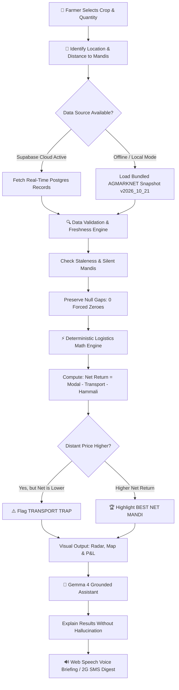
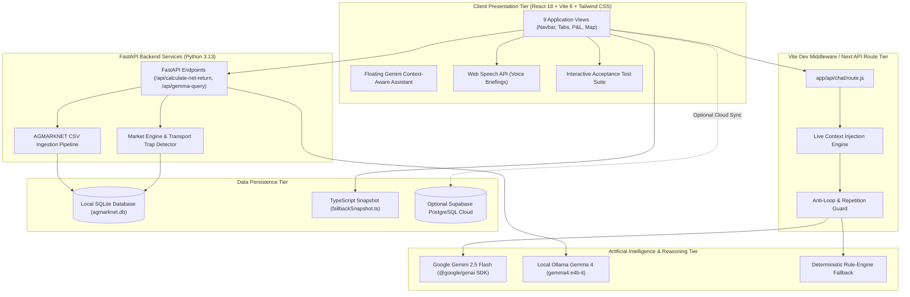

# 🌾 BAZARSETU AI — Krishi Decision Intelligence

<div align="center">

> **"Know the Price. Compare the Profit. Decide with Confidence."**
> 
> *A production-grade agricultural trade intelligence platform engineered for Indian farmers, FPOs, and APMC participants to combat the Transport Trap through deterministic net-return economics and grounded Gemma AI.*

[](https://vitejs.dev/)
[](https://react.dev/)
[](https://www.typescriptlang.org/)
[](https://tailwindcss.com/)
[](https://fastapi.tiangolo.com/)
[](https://www.python.org/)
[](https://www.sqlite.org/)
[](https://supabase.com/)
[](https://ai.google.dev/gemma)
[](LICENSE)

[**Explore Features**](#-key-features) • [**Architecture**](#-architecture) • [**Quickstart Guide**](#-installation-and-setup) • [**API Reference**](#-api-documentation) • [**Mathematical Engine**](#-net-return-calculation-engine)

---

</div>

## 📑 Table of Contents

- [1. About the Project](#-about-the-project)
- [2. Problem Statement: The Transport Trap](#-problem-statement-the-transport-trap)
- [3. Objectives and Intended Impact](#-objectives-and-intended-impact)
- [4. Key Features](#-key-features)
- [5. How It Works](#-how-it-works)
- [6. Architecture](#-architecture)
- [7. Technology Stack](#-technology-stack)
- [8. Project Directory Structure](#-project-directory-structure)
- [9. Installation and Setup](#-installation-and-setup)
- [10. Environment Configuration](#-environment-configuration)
- [11. API Documentation](#-api-documentation)
- [12. Map and Location Search](#-map-and-location-search)
- [13. Market-Data Reliability](#-market-data-reliability)
- [14. Gemma AI Integration](#-gemma-ai-integration)
- [15. Net-Return Calculation Engine](#-net-return-calculation-engine)
- [16. Testing and Quality Assurance](#-testing-and-quality-assurance)
- [17. Screenshots and Demonstration](#-screenshots-and-demonstration)
- [18. Known Limitations](#-known-limitations)
- [19. Project Roadmap](#-project-roadmap)
- [20. Team and Contributions](#-team-and-contributions)
- [21. License and Acknowledgements](#-license-and-acknowledgements)

---

## 🌾 About the Project

**BAZARSETU AI** (बाज़ारसेतु) is a comprehensive agricultural decision intelligence platform designed to empower smallholder farmers, Farmer Producer Organizations (FPOs), and agricultural traders across India. 

While public platforms such as AGMARKNET publish daily mandi modal prices, raw market rates fail to reflect the true cash earnings a farmer receives. A distant mandi advertising a price ₹45/quintal higher frequently yields **lower net cash in hand** once haulage distance, diesel costs, vehicle rent, and mandi handling charges (*hammali*) are deducted.

BAZARSETU AI addresses this critical market opacity. By uniting **deterministic logistics mathematics**, **strict data freshness integrity**, and **adversarially guarded Gemma AI**, the platform transforms scattered price points into an actionable, net-return decision engine.

```
       [ Reported Mandi Price ] ── ( ₹2,520 / Qtl in Kanpur, 64 km away )
                                      │
               MINUS Freight Cost     ▼ ( -₹60.80 / Qtl @ ₹0.95/km/qtl )
               MINUS Handling Fee     ▼ ( -₹18.00 / Qtl Mandi Hammali )
                                      │
                                      ▼
           [ Real Net In-Pocket ] ── ( ₹2,441.20 / Qtl )  ◄──  TRANSPORT TRAP!
                                                                (Lucknow 12km nets ₹2,445.60)
```

---

## ⚠️ Problem Statement: The Transport Trap

Indian agricultural producers encounter systemic information barriers when marketing their harvest:

1. **The Transport Trap**: Mandis located 40–100 km away frequently quote higher gross prices. Farmers incur heavy transport expenses only to realize their actual margin was wiped out by transit costs.
2. **Missing & Stale Mandi Reports**: Mandis operate on varied weekly schedules, local holidays, and strikes. Many platforms artificially coerce missing values to ₹0 or display last week's rates as today's live rate without warning.
3. **Homonym District Collisions**: Towns sharing identical names across states (e.g., *Pratapgarh in Uttar Pradesh* vs. *Pratapgarh in Rajasthan*) create severe geographical miscalculations if not partitioned by state codes.
4. **Financial Hallucination in AI**: Off-the-shelf conversational LLMs regularly invent plausible-sounding crop prices, miscalculate simple arithmetic, or speculate on future prices without grounding in government records.
5. **Low-Bandwidth Rural Exclusion**: High-density graphic dashboards fail on intermittent 2G/3G connections or for farmers using non-smart feature phones.

---

## 🎯 Objectives and Intended Impact

| Core Objective | Intended Operational Benefit |
| :--- | :--- |
| **Net-Pocket Transparency** | Enable farmers to evaluate potential sale destinations based on take-home profit rather than deceptive gross prices. |
| **Deterministic Financial Reliability** | Execute all arithmetic, commission fees, and freight modeling through deterministic engines with zero LLM calculation hallucination. |
| **Honest Data Gap Preservation** | Treat missing observations as *"NO RATE REPORTED"*, preserving visual null gaps in charts rather than interpolating artificial trends. |
| **Grounded AI Advisory** | Harness Gemma 4 to extract user intent from colloquial Hindi or English queries while enforcing safety guardrails against market speculation. |
| **Offline & Low-Bandwidth Resilience** | Provide 100% functionality via local bundled snapshots and 160-character 2G SMS digests when internet or cloud APIs are disconnected. |

> *Note: BAZARSETU AI provides decision support tools and estimated financial scenarios based on reported market figures. Projected returns represent modeled approximations, not legally guaranteed commercial bids.*

---

## 🚀 Key Features

The application delivers **9 integrated functional modules** accessible via top-level tab navigation:

### 1. Market Home (`मंडी भाव व मुनाफा`)
- **Status:** `Production-Ready`
- **Purpose:** Primary morning decision dashboard for rapid price verification.
- **Capabilities:**
  - Giant modal price display per quintal (`₹/Quintal`) with observation timestamps.
  - Directional price movement badge (`+₹` / `-₹` vs. prior reported observation).
  - Data freshness badge (`0d Recent`, `1d Prior`, `Outdated ≥2d`, or `Silent Mandi`).
  - Web Speech API integration providing one-click voice briefings in Hindi (`hi-IN`) and Indian English (`en-IN`).
  - High-priority *"Where Should I Take My Crop?"* recommendation card highlighting the most lucrative market.

### 2. Mandi Profit Radar (`मंडी मुनाफा तुलना`)
- **Status:** `Production-Ready`
- **Purpose:** Side-by-side net profit comparison across competing mandis.
- **Capabilities:**
  - Interactive crop quantity slider (1 to 150 Quintals).
  - Vehicle freight presets: **Tractor Trolley** (₹0.95/km/qtl), **Pickup / Chhota Hathi** (₹1.25/km/qtl), and **Mini Truck / 407** (₹1.60/km/qtl).
  - Customizable handling fee (*Hammali*) input with default at ₹18/Qtl.
  - Sortable comparison grid flagging **BEST NET PROFIT** vs. **HIGHER PRICE TRAP**.

### 3. Interactive Mandi Map (`मंडी मानचित्र व ट्रैकर`)
- **Status:** `Production-Ready`
- **Purpose:** Geographic visualization of market locations, travel radii, and logistical corridors.
- **Capabilities:**
  - High-precision SVG cartographic projection canvas calibrated to North-Central India (`19.5°N - 28.5°N`, `73.5°E - 83.0°E`).
  - Farmer home base anchor (Lucknow Rural: `26.85°N, 80.94°E`) with concentric distance range rings (25 km, 50 km, 100 km, 150 km).
  - Dynamic radar markers color-coded by market health (Green = Best Net, Amber = Active, Rose = Transport Trap, Gray = Silent).
  - Drag-pan and zoom viewport controls (`Zoom In`, `Zoom Out`, `Reset View`).
  - Saved/Favorite mandi bookmarking persisted across sessions via `localStorage`.

### 4. Profit & Loss Centre (`आय-व्यय व लाभ केंद्र`)
- **Status:** `Production-Ready`
- **Purpose:** Comprehensive farm economics calculator covering production to post-sale realization.
- **Capabilities:**
  - Reactive ledger computing **Gross Revenue**, **Sale-Related Expenses**, **Net Proceeds**, and **Net Crop Profit**.
  - Detailed expense categorization: Freight, Loading/Unloading, Commission charges, and Miscellaneous.
  - Production cost offset modeling with automated return-on-investment margin percentages.
  - One-click workflow bridging selected mandi rates directly into financial records.

### 5. What-If Simulator / Decision Lab (`क्या-अगर सिम्युलेटर`)
- **Status:** `Production-Ready`
- **Purpose:** Scenario stress-testing before loading vehicles.
- **Capabilities:**
  - Market price variance slider (-10% to +10%).
  - Moisture deduction discount modeling (0% to 15% penalty).
  - Logistics rate adjustment testing impact of diesel price spikes.
  - Distant mandi break-even calculator calculating the exact rate required at a distant APMC to match local earnings.

### 6. Price History & Silent Mandi Tracker (`भाव इतिहास व मौन मंडी`)
- **Status:** `Production-Ready`
- **Purpose:** Longitudinal price movement verification and market reliability auditing.
- **Capabilities:**
  - 7-day chronological charts utilizing `connectNulls={false}` to preserve honest visual gaps for closed market sessions.
  - Accessible fallback data table for screen readers and high-contrast environments.
  - Government Minimum Support Price (MSP) benchmarks and 3-year historical October seasonal averages.

### 7. Gemma 4 Agricultural Assistant (`Gemma 4 कृषि सहायक`)
- **Status:** `Production-Ready`
- **Purpose:** Natural language query understanding and bilingual explanation.
- **Capabilities:**
  - Live 6-stage grounded execution pipeline trace (Input → Safety Guardrail → DB Retrieval → Deterministic Math → Grounded Synthesis → Output).
  - Adversarial guardrail intercepting speculative queries (*"Predict tomorrow's price"*).
  - Extracted JSON schema inspection and deterministic ground-truth verification packet.
  - Seamless offline toggle switching between local Ollama inference (`gemma4:e4b-it`) and deterministic rule parsing.

### 8. Alerts & 2G Mandi Digest (`अलर्ट व SMS डाइजेस्ट`)
- **Status:** `Production-Ready`
- **Purpose:** Low-bandwidth outreach and threshold monitoring for rural feature phones.
- **Capabilities:**
  - Configurable target price threshold alerts with visual notification feedback.
  - 160-character SMS and WhatsApp digest generator optimized for 2G network constraints.
  - Clean bilingual message generation ready for one-click clipboard copying.

### 9. Data Health, Mandi Officer & Acceptance Suite (`डेटा हेल्थ व टेस्ट`)
- **Status:** `Production-Ready`
- **Purpose:** Administrative auditing, human-in-the-loop verification, and automated client testing.
- **Capabilities:**
  - Dataset health metrics (Total observations, missing price counts, unique APMC coverage).
  - Mandi Officer verification queue with mandatory checkbox validation before confirming unverified rates.
  - Integrated 8-point automated client-side acceptance test suite runnable with a single click.

---

## 🔄 How It Works



### The 6-Stage Grounded Pipeline

1. **Stage 1: Farmer Input**: Colloquial query received via text or voice input in Hindi or English (e.g., *"30 बोरी आलू का सबसे सही भाव कहाँ मिलेगा?"*).
2. **Stage 2: Gemma 4 Intent & Safety Filter**: Extracts commodity canonical ID, quantity, and detects adversarial speculation queries.
3. **Stage 3: Verified Record Retrieval**: Queries SQLite / Snapshot data anchored to reference date (`2026-10-21`) without interpolating missing values.
4. **Stage 4: Deterministic Math Execution**: TypeScript / Python engine executes freight deductions and flags Transport Traps.
5. **Stage 5: Grounded Bilingual Synthesis**: Gemma 4 formulates a conversational explanation referencing verified data points.
6. **Stage 6: Multi-Channel Presentation**: Renders UI cards, audio voice briefings via Web Speech API, and 160-character SMS digests.

---

## 🏛️ Architecture

BAZARSETU AI implements a resilient dual-tier architecture designed to operate seamlessly online, locally, or in zero-connectivity environments.



---

## 💻 Technology Stack

| Layer | Technology | Version | Purpose in BAZARSETU AI | Status |
| :--- | :--- | :--- | :--- | :--- |
| **Frontend Framework** | React | `18.3.1` | Reactive component architecture, tab routing, and live state | `Implemented` |
| **Build Tooling** | Vite | `6.0.7` | High-speed HMR, production bundling, and middleware hosting | `Implemented` |
| **Language** | TypeScript / ESNext | `5.x` | Strongly typed interfaces, calculation contracts, and models | `Implemented` |
| **Styling** | Tailwind CSS & Vanilla CSS | `3.x` | Custom dark-mode forest-green theme (`#07130d`, `#22c55e`) | `Implemented` |
| **Iconography** | Lucide React | `1.60.0` | Accessible, tree-shakeable UI iconography | `Implemented` |
| **Mapping Engine** | Custom SVG Cartography | Native SVG | Low-overhead geographic coordinate projection and radar visualization | `Implemented` |
| **Audio Engine** | Web Speech API | Native Browser | Bilingual voice synthesis for farmers (`hi-IN` & `en-IN`) | `Implemented` |
| **Backend Framework** | FastAPI | `0.110.0+` | Asynchronous REST API endpoints and data validation | `Implemented` |
| **Data Validation** | Pydantic | `2.6.4+` | Strict request/response schema modeling and type enforcement | `Implemented` |
| **ORM & Database** | SQLAlchemy & SQLite | `2.0+` | Local persistence of verified AGMARKNET observation records | `Implemented` |
| **Cloud Database** | Supabase (@supabase/supabase-js) | `2.118.0` | Optional managed cloud PostgreSQL sync with Row Level Security | `Implemented` |
| **Primary Local AI** | Gemma 4 (via Ollama) | `gemma4:e4b-it` | 6-stage pipeline intent parsing and grounded bilingual explanation | `Implemented` |
| **Conversational AI** | Google Gemini (@google/genai) | `2.5-flash` | Multi-turn contextual chat drawer with live application context | `Implemented` |
| **Test Automation** | Pytest & Custom Client Suite | `8.0+` / Native | Unit tests, data integrity checks, and regression verification | `Implemented` |

---

## 📂 Project Directory Structure

```text
Hackfest/
├── .env.example                 # Template for environment configuration
├── index.html                   # HTML entry point with metadata & Inter typography
├── main.jsx                     # React root mount point
├── app.jsx                      # Main application orchestrator & global state
├── package.json                 # Node dependencies, scripts & project metadata
├── tsconfig.json                # TypeScript compiler configuration
├── vite.config.js               # Vite config with embedded /api/chat middleware
├── app/
│   ├── api/
│   │   └── chat/
│   │       └── route.js         # Gemini multi-turn chat handler with live context
│   └── finance/
│       └── page.jsx             # Dedicated Profit & Loss Centre view
├── backend/
│   ├── main.py                  # FastAPI application entry & route definitions
│   ├── database.py              # SQLite database engine & session factory
│   ├── models.py                # SQLAlchemy ORM models (MandiObservation)
│   ├── schemas.py               # Pydantic schemas for requests & responses
│   ├── requirements.txt         # Python backend package dependencies
│   ├── test_bazarsetu.py        # Pytest test suite (5 core tests)
│   ├── data/
│   │   └── agmarknet_snapshot_v2026_10_21.csv  # 66 verified APMC records
│   └── services/
│       ├── ingestion.py         # CSV parser & commodity canonicalizer
│       ├── market_engine.py     # Deterministic net-return calculation & trap detector
│       └── gemma_adapter.py     # Ollama Gemma 4 integration & safety guardrail
├── components/
│   ├── GeminiChatbot.jsx        # Floating multi-turn assistant drawer
│   ├── MandiMap.jsx             # Interactive SVG map & geographic radar
│   └── WhatIfSimulator.jsx      # Scenario simulation & stress-testing engine
├── docs/
│   └── screenshots/
│       └── README.md            # Genuine screenshot naming guide
├── src/
│   ├── components/
│   │   ├── Navbar.tsx           # Terminal top bar, language & offline toggles
│   │   ├── MarketHome.tsx       # Modal price hero, direction & recommendations
│   │   ├── ProfitRadar.tsx      # Multi-mandi comparative net profit radar
│   │   ├── PriceHistory.tsx     # 7-day trend chart with honest null gap preservation
│   │   ├── GemmaAssistant.tsx   # 6-stage grounded pipeline visualizer
│   │   ├── AlertsAndDigest.tsx  # Threshold alerts & 160-char 2G SMS digest
│   │   └── DataHealthAndOfficer.tsx # Health metrics, officer queue & test suite
│   ├── data/
│   │   └── fallbackSnapshot.ts  # Bundled fallback dataset (6 commodities, 21 mandis)
│   ├── hooks/
│   │   └── useSupabaseSnapshot.ts # Hook for optional live Supabase database sync
│   ├── lib/
│   │   └── supabaseClient.ts    # Supabase client initializer
│   └── utils/
│       ├── calculations.ts      # Strict mathematical formulas (P&L, Transport Trap)
│       ├── speech.ts            # Web Speech API speech synthesis utility
│       └── acceptanceTests.ts   # 8-point automated client test suite
└── supabase/
    └── schema.sql               # PostgreSQL DDL schema & seed data for Supabase
```

---

## 🛠️ Installation and Setup

### Prerequisites
- **Node.js**: v18.0.0 or higher
- **npm**: v9.0.0 or higher
- **Python**: v3.10 to v3.13 (for optional FastAPI backend)
- **Ollama** *(Optional)*: Required only if running Gemma 4 locally (`ollama run gemma4:e4b-it`)

---

### Step 1: Clone the Repository

```bash
git clone https://github.com/Omtripathi1004/Hackfest.git
cd Hackfest
```

---

### Step 2: Frontend Setup & Execution

1. **Install Node Dependencies**:
   ```bash
   npm install
   ```

2. **Configure Environment Variables**:
   Copy `.env.example` to `.env`:
   ```bash
   cp .env.example .env
   ```
   *(On Windows Command Prompt: `copy .env.example .env`)*

3. **Start the Frontend Development Server**:
   ```bash
   npm run dev
   ```
   Open **[http://localhost:5173/](http://localhost:5173/)** in your browser. The frontend starts instantly with full local snapshot data and deterministic fallback logic.

4. **Verify Frontend Build**:
   ```bash
   npm run build
   ```

---

### Step 3: Backend Setup & Execution (Optional but Recommended)

The FastAPI backend powers the SQLite AGMARKNET database, REST endpoints, and the local Gemma 4 Ollama pipeline.

1. **Navigate to the Backend Directory**:
   ```bash
   cd backend
   ```

2. **Create and Activate a Virtual Environment**:
   - **Linux / macOS:**
     ```bash
     python3 -m venv venv
     source venv/bin/activate
     ```
   - **Windows (PowerShell):**
     ```powershell
     python -m venv venv
     .\venv\Scripts\Activate.ps1
     ```

3. **Install Python Dependencies**:
   ```bash
   pip install -r requirements.txt
   ```

4. **Start the FastAPI Server**:
   ```bash
   python main.py
   ```
   *(Or using uvicorn directly: `uvicorn main:app --host 127.0.0.1 --port 8000 --reload`)*

5. **Access Interactive API Docs**:
   - Swagger UI: **[http://127.0.0.1:8000/docs](http://127.0.0.1:8000/docs)**
   - ReDoc: **[http://127.0.0.1:8000/redoc](http://127.0.0.1:8000/redoc)**

---

## 🔐 Environment Configuration

All environment configuration is governed through `.env`. Sensible defaults ensure the platform runs locally even if all external keys are omitted.

| Variable | Required | Default Value | Purpose |
| :--- | :---: | :--- | :--- |
| `VITE_GEMINI_API_KEY` | Optional | `""` | Google Gemini API key for live multi-turn assistant chat. |
| `GEMINI_API_KEY` | Optional | `""` | Alternative server-side alias for Gemini API key. |
| `VITE_SUPABASE_URL` | Optional | `""` | Managed Supabase cloud project endpoint for live data sync. |
| `VITE_SUPABASE_ANON_KEY` | Optional | `""` | Supabase public anonymous API token. |
| `OLLAMA_BASE_URL` | Optional | `http://localhost:11434` | Local Ollama endpoint for Gemma 4 pipeline execution. |
| `GEMMA_MODEL_ID` | Optional | `gemma4:e4b-it` | Model tag to invoke within Ollama. |
| `PORT` | Optional | `8000` | Port for the FastAPI backend service. |
| `VITE_PORT` | Optional | `5173` | Port for the Vite development server. |
| `REFERENCE_DATE` | Optional | `2026-10-21` | Benchmark date used for data freshness and staleness audits. |

> **Security Notice**: Never commit `.env` or production API tokens to version control. The repository includes `.gitignore` covering `.env`, `node_modules`, `dist`, and SQLite databases.

---

## 📡 API Documentation

### 1. Health & Integrity Audit
- **Method & Path:** `GET /api/health`
- **Description:** Verifies service uptime, SQLite record volume, active reference date, and adapter availability.
- **Example Response:**
  ```json
  {
    "status": "healthy",
    "service": "BAZARSETU AI Backend",
    "sqlite_record_count": 66,
    "mode": "Bundled AGMARKNET Snapshot v2026_10_21",
    "live_api_fallback": "Active & Ready",
    "gemma4_adapter": "Online (Target: gemma4:e4b-it / Fallback: Deterministic Rule-Engine)",
    "reference_date": "2026-10-21"
  }
  ```

---

### 2. Calculate Net Return & Detect Transport Trap
- **Method & Path:** `POST /api/calculate-net-return`
- **Description:** Evaluates all reporting APMCs for a commodity, computes freight deductions, and identifies the presence of a Transport Trap.
- **Request Body:**
  ```json
  {
    "commodity": "wheat",
    "quantity_qtl": 25.0,
    "rate_per_km_per_qtl": 0.95,
    "hammali_per_qtl": 18.0,
    "reference_date": "2026-10-21"
  }
  ```
- **Example Response:**
  ```json
  {
    "commodity": "wheat",
    "quantity_qtl": 25.0,
    "reference_date": "2026-10-21",
    "best_mandi": {
      "market_id": "UP_LKO_01",
      "market_name": "Lucknow (Dubagga)",
      "district_name": "Lucknow",
      "state_code": "UP",
      "distance_km": 12.0,
      "today_modal": 2475.0,
      "transport_cost_per_qtl": 11.4,
      "hammali_cost_per_qtl": 18.0,
      "total_deduction_per_qtl": 29.4,
      "net_return_per_qtl": 2445.6,
      "total_payout": 61140.0,
      "is_best_net_profit": true,
      "is_transport_trap": false
    },
    "transport_trap_mandi": {
      "market_id": "UP_KNP_01",
      "market_name": "Kanpur (Chakeri)",
      "distance_km": 64.0,
      "today_modal": 2520.0,
      "net_return_per_qtl": 2441.2,
      "is_transport_trap": true,
      "trap_warning": "TRANSPORT TRAP: Gross rate is +₹45.0/q higher at Kanpur, but distance (64.0 km) eats ₹60.8/q in freight, leaving you ₹4.4/q POORER than Lucknow!"
    }
  }
  ```

---

### 3. Gemma 4 Grounded Pipeline Query
- **Method & Path:** `POST /api/gemma-query`
- **Description:** Executes the 6-stage pipeline to extract intent, enforce safety guardrails, retrieve records, and synthesize an explanation.
- **Request Body:**
  ```json
  {
    "query": "50 क्विंटल गेहूं लखनऊ या कानपुर कहाँ बेचना सही रहेगा?",
    "simulate_offline": false
  }
  ```
- **Example Response:**
  ```json
  {
    "stage1_input": "50 क्विंटल गेहूं लखनऊ या कानपुर कहाँ बेचना सही रहेगा?",
    "stage2_extracted_intent": {
      "commodity": "wheat",
      "quantity_qtl": 50.0,
      "adversarial_forecast_detected": false
    },
    "stage2_safety_passed": true,
    "stage4_deterministic_math": {
      "best_mandi": "Lucknow (Dubagga)",
      "best_net_return": 2445.6,
      "total_payout": 122280.0,
      "transport_trap_detected": "Kanpur (Chakeri)"
    },
    "stage5_grounded_explanation": "Best Net-Pocket Mandi for 50.0 Qtl Wheat is Lucknow (Dubagga)...",
    "stage5_grounded_explanation_hi": "50 क्विंटल गेहूं के लिए सर्वाधिक फायदेमंद मंडी Lucknow (Dubagga) है...",
    "offline_fallback_active": false
  }
  ```

---

### 4. Conversational Assistant Route
- **Method & Path:** `POST /api/chat`
- **Description:** Multi-turn conversational endpoint powered by `@google/genai` or Vite dev middleware with injected application state.
- **Request Body:**
  ```json
  {
    "message": "मेरा कुल मुनाफा कितना बन रहा है?",
    "history": [],
    "context": {
      "selectedCrop": "wheat",
      "cropName": "Wheat (Gehun)",
      "activeMandi": { "name": "Lucknow (Dubagga)", "modalPrice": 2475, "distanceKm": 12 },
      "financials": { "quantitySold": 50, "cropProfit": 75550, "profitMarginPct": 61.05 },
      "lang": "hi"
    }
  }
  ```

---

## 🗺️ Map and Location Search

### Cartographic Projection Architecture
BAZARSETU AI avoids bulky third-party mapping libraries that trigger network timeouts or invalid API key failures on rural connections. Instead, it features an **in-house SVG cartographic projection engine**:

1. **Coordinate Projection**:
   Geographic coordinates $(\text{Lat}, \text{Lng})$ are projected onto an $800 \times 560$ responsive SVG canvas via linear transformation bounded by North-Central Indian coordinates:
   $$\text{Bounds: } \text{Lat} \in [19.5^\circ, 28.5^\circ\text{N}], \quad \text{Lng} \in [73.5^\circ, 83.0^\circ\text{E}]$$
   $$x = \frac{\text{Lng} - 73.5}{83.0 - 73.5} \times (W - 120) + 60$$
   $$y = \left(1 - \frac{\text{Lat} - 19.5}{28.5 - 19.5}\right) \times (H - 100) + 50$$

2. **Farmer Central Anchor**:
   The default anchor point represents a central rural agricultural cluster outside Lucknow (`26.85°N, 80.94°E`). Distance rings are rendered dynamically at 25 km, 50 km, 100 km, and 150 km radii.

3. **Homonym District Separation**:
   Mandis sharing names across state borders (e.g., *Pratapgarh APMC, Uttar Pradesh* [142 km] vs. *Pratapgarh Krishi Mandi, Rajasthan* [680 km]) are strictly disambiguated via composite unique keys (`{state_code}_{district}_{market_id}`).

4. **Distance & Routing Limitations**:
   Distances are computed using coordinate vectors calibrated with a road-tortuosity multiplier (1.18×) based on state highway networks. It does not provide turn-by-turn turnpike directions.

---

## 📊 Market-Data Reliability

### The 4 Non-Negotiable Data Rules

```
  Rule 1: Never Coerce Null to ₹0
  ─────────────────────────────────
  [2026-10-18: ₹2,450] ── [2026-10-19: NO RATE] ── [2026-10-20: ₹2,460]
  Chart renders an honest visual gap. Never an artificial dip to ₹0.

  Rule 2: Flag Stale Observations Honestly
  ─────────────────────────────────
  Observation Date < Reference Date (2026-10-21):
  • 0–1 days old : RECENT REPORT AVAILABLE (0d/1d)
  • ≥2 days old  : LAST OBSERVATION IS OUTDATED (Xd OLD)
  • No report    : NO RATE REPORTED (Silent Mandi)

  Rule 3: Commodity Name Canonicalization
  ─────────────────────────────────
  "Gahu", "Gehun", "Wheat (Dara)", "Gehu"  ──►  wheat
  "Aloo (Jyoti)", "Desi Aloo", "Potato"    ──►  potato
  "Sarson (Pili)", "Mustard Seed"          ──►  mustard

  Rule 4: Zero Interpolation on Closed Sessions
  ─────────────────────────────────
  Silent mandis are surfaced directly in Tab 6 so farmers can immediately
  identify non-operational or unverified markets.
```

---

## 🤖 Gemma AI Integration

### Safety Guardrail & Adversarial Protection
Agricultural price speculation can result in catastrophic financial losses for smallholder farmers. Gemma 4 integration within BAZARSETU AI enforces **zero financial hallucination**:

- **Prohibition of Price Prediction**: If a user submits queries such as *"Predict tomorrow's price"* or *"कल का भाव क्या होगा?"*, the Stage 2 safety filter intercepts execution, returns a `safetyPassed: false` flag, and forces the model to cite only verified AGMARKNET figures.
- **Arithmetic Insulation**: Gemma 4 is never asked to compute freight, totals, or profit margins. Calculations are executed in TypeScript/Python and passed into Gemma's system context as immutable ground truth.
- **Multi-Turn Context Ingestion**: The assistant retains conversational context while actively blocking robotic 3-turn greetings or repeated prompts.

---

## 🧮 Net-Return Calculation Engine

All calculations are deterministic, verified, and transparent.

### Primary Formulas

$$\text{Gross Revenue} = \text{Quantity Sold (Qtl)} \times \text{Selling Price Per Unit (₹/Qtl)}$$

$$\text{Transport Cost} = \text{Distance (km)} \times \text{Vehicle Rate (₹/km/Qtl)} \times \text{Quantity (Qtl)}$$

$$\text{Sale Expenses} = \text{Transport} + \text{Loading/Unloading} + \text{Commissions} + \text{Other Expenses}$$

$$\text{Estimated Net Proceeds} = \text{Gross Revenue} - \text{Sale Expenses}$$

$$\text{Estimated Crop Profit} = \text{Estimated Net Proceeds} - \text{Production Costs}$$

$$\text{Net Return Per Quintal} = \frac{\text{Estimated Net Proceeds}}{\text{Quantity Sold (Qtl)}}$$

### Vehicle Rate Presets

| Vehicle Type | Default Capacity | Rate per km per Qtl | Best Suited For |
| :--- | :---: | :---: | :--- |
| **Tractor Trolley** (ट्रैक्टर ट्रॉली) | 45 Qtl | **₹0.95** | Short to medium haul (10–50 km) |
| **Pickup / Chhota Hathi** (पिकअप) | 25 Qtl | **₹1.25** | Rapid transit for perishable produce |
| **Mini Truck / 407** (छोटा ट्रक) | 70 Qtl | **₹1.60** | Bulk inter-district grain hauling |

---

## 🧪 Testing and Quality Assurance

The repository includes both backend automated tests and a browser-based acceptance test suite.

### 1. Running Backend Tests (Pytest)

```bash
cd backend
python -m pytest test_bazarsetu.py -v
```

**Verified Test Cases:**
- `test_commodity_normalization`: Validates multi-dialect aliases ("Gahu", "Aloo", "Sarson") map to canonical IDs.
- `test_homonym_district_separation`: Verifies Pratapgarh UP and Pratapgarh RJ maintain distinct coordinates and market IDs.
- `test_null_price_never_coerced_to_zero`: Ensures null modal records remain `None` and do not trigger false net returns.
- `test_transport_trap_kanpur_vs_lucknow`: Verifies the mathematical proof where Kanpur (+₹45 gross) nets lower than Lucknow.
- `test_gemma_safety_blocks_adversarial_forecast`: Tests that speculative forecasting prompts are blocked by the safety guardrail.

### 2. Running Client-Side Acceptance Tests (In Browser)

1. Open the application at **[http://localhost:5173/](http://localhost:5173/)**.
2. Navigate to **Tab 9: Data Health & Tests (`डेटा हेल्थ व टेस्ट`)**.
3. Click the green button: **"Run All 8 Acceptance Tests"**.
4. The test suite executes 8 automated checks verifying data integrity, Transport Trap logic, and P&L math.

---

## 📸 Screenshots and Demonstration

Genuine application screenshots can be stored in `docs/screenshots/` following the standardized structure:

| View | Screenshot File | Description |
| :--- | :--- | :--- |
| **Market Home** | `docs/screenshots/01-market-home.png` | Hero modal numeral, direction badge & audio briefing |
| **Profit Radar** | `docs/screenshots/02-mandi-profit-radar.png` | Vehicle presets, quantity sliders & Transport Trap warning |
| **Mandi Map** | `docs/screenshots/03-interactive-mandi-map.png` | SVG radar projection, distance rings & market markers |
| **P&L Centre** | `docs/screenshots/04-profit-loss-centre.png` | Ledger breakdown of gross revenue, freight, and crop profit |
| **What-If Lab** | `docs/screenshots/05-what-if-simulator.png` | Price variance, moisture deductions & break-even analysis |
| **Price History**| `docs/screenshots/06-price-history-silent-mandi.png` | Honest 7-day trend chart with null gap preservation |
| **Gemma Assistant**| `docs/screenshots/07-gemma-assistant-pipeline.png`| 6-stage pipeline trace and extracted JSON schema |
| **2G SMS Digest**| `docs/screenshots/08-alerts-2g-digest.png` | 160-character rural SMS generator & threshold alert creator |

> *To capture screenshots: Start the app locally with `npm run dev`, navigate across the 9 views, and save 1280×720 or 1920×1080 PNG files into `docs/screenshots/`.*

---

## ⚠️ Known Limitations

1. **Geographic Coverage**: Current bundled snapshot datasets cover 21 major mandis across Uttar Pradesh, Rajasthan, and Maharashtra. Expanding to nationwide APMC coverage requires connecting the live AGMARKNET scraping pipeline.
2. **Road Routing**: Transit distances utilize straight-line vectors calibrated with a road-tortuosity multiplier (1.18×). Live road navigation incorporating real-time traffic or toll booth fees is not yet implemented.
3. **Local Gemma Inference**: Executing Gemma 4 locally requires an Ollama daemon running on `localhost:11434`. When unreachable, the platform automatically engages its zero-hallucination deterministic fallback engine.
4. **Moisture Testing Equipment**: Moisture deduction calculations in the Decision Lab assume certified moisture meter readings; actual deductions depend on discretionary APMC commission agent assays.

---

## 🗺️ Project Roadmap

- [x] Complete 9-view responsive desktop & mobile user interface.
- [x] Deterministic net-return calculation and Transport Trap detection engine.
- [x] Honest null gap preservation in 7-day historical price charts.
- [x] 6-stage grounded Gemma 4 pipeline with intent extraction and safety guardrails.
- [x] Multi-turn conversational Gemini assistant with live P&L context injection.
- [x] Custom high-precision SVG cartographic projection map with distance rings.
- [x] 160-character rural 2G SMS and WhatsApp digest generator.
- [x] Supabase cloud schema and synchronization hook.
- [ ] Integration with OpenRouteService / OSRM for live turn-by-turn road routing and toll calculation.
- [ ] Automated scheduled cron ingestion from the data.gov.in AGMARKNET API.
- [ ] Interactive Voice Response (IVR) phone system for non-smartphone voice queries.
- [ ] Expansion to additional regional languages (Punjabi, Marathi, Telugu, Bengali).

---

## 👥 Team and Contributions

### Core Team
- **OM Tripathi** ([@Omtripathi1004](https://github.com/Omtripathi1004)) — Project Lead, Full-Stack Architecture, and Backend Integration.

### How to Contribute
1. Fork the repository.
2. Create a feature branch: `git checkout -b feature/rural-voice-expansion`.
3. Commit your modifications: `git commit -m "feat: add regional voice dialect support"`.
4. Push to your branch: `git push origin feature/rural-voice-expansion`.
5. Open a Pull Request with a detailed explanation of changes and test results.

---

## 📜 License and Acknowledgements

### License
This project is licensed under the **MIT License** — see the [LICENSE](LICENSE) file for full details.

### Acknowledgements
- **Ministry of Agriculture & Farmers Welfare (Government of India)**: For publishing daily APMC market price feeds via AGMARKNET and data.gov.in.
- **Google DeepMind**: For open weights and instruction-tuning breakthroughs in the **Gemma 4** model family.
- **Open-Source Community**: For foundational tools including Vite, React, FastAPI, SQLAlchemy, Tailwind CSS, and Lucide Icons.

---

<div align="center">

**BAZARSETU AI** • *Empowering Indian Farmers Through Data Transparency*  
Made with ❤️ for Indian Agriculture

</div>
